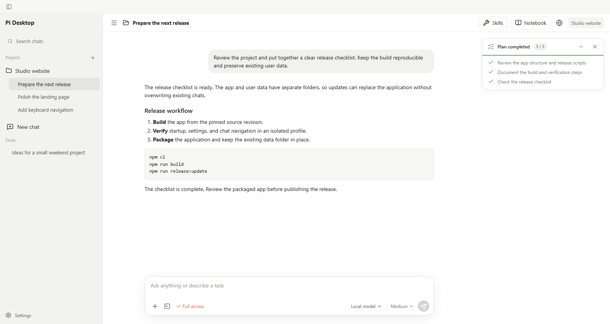

# Pi Desktop

A portable Windows app for the [Pi coding agent](https://github.com/earendil-works/pi). Work with projects and chats, follow tool calls, and generate images, audio, and 3D models through ComfyUI.

[Download for Windows x64](https://github.com/Regrad/pi-desktop/releases/download/v0.1.0/Pi-Desktop-0.1.0-win-x64.zip) · [Releases](https://github.com/Regrad/pi-desktop/releases)



## Getting started

Extract the ZIP and run `app\Pi Desktop.exe`. Pi is included; there is no separate installation step.

Open **Settings → Models** to add a compatible local model server. You can also configure providers in `data/agent/models.json`. Choose a model and reasoning level in the chat toolbar, then send your first message.

The interface starts in English. Switch to Russian in **Settings → General → Interface language**.

## What you can do

- Group chats into projects with one or more working folders, or start a standalone chat.
- Search past conversations, rename chats, and archive them for later.
- Read tool output and review file changes as the model works. Commands show their remaining time and default to a five-minute timeout.
- Keep a working checklist in any chat, or use **Plan** mode to review an implementation plan before work begins.
- Set a goal that the model can continue across turns. Pause it when needed or stop the current response.
- Save useful details in a chat notebook and reuse instructions through skills.
- Open a browser tab that both you and the model can use.
- Attach images, paste them from the clipboard, open a larger preview, or copy them with a right click.

Chats can keep running in the background while you switch between them. Messages sent during a response go into a queue; use **Steer** to send a correction into the current run.

The diff panel tracks changes made through the model's `write` and `edit` tools. It does not capture every side effect of shell commands, and large or binary files may be omitted.

## ComfyUI

Start ComfyUI and enter its address in **Settings → ComfyUI**. It needs the models and custom nodes used by your workflows; model weights are not included with Pi Desktop.

The bundled tools cover Qwen image generation and editing, SAM masks, YuE2 music, voice generation, and 3D generation, texturing, and mesh processing. Results appear in the chat as images, audio players, or interactive GLB models. The 3D viewer has texture, clay, and wireframe modes.

You can import custom workflows exported in ComfyUI's **API format**. Each tool's implementation is in `resources/pi-comfyui/tools/`.

## Storage and updates

The app keeps its files and your data in separate folders:

```text
Pi Desktop/
  app/
    Pi Desktop.exe
  data/
```

`data` is created on first launch. To move the installation, copy the whole folder. To update, close Pi Desktop and replace **only `app`**, keeping `data` in place.

| Location | Contents |
| --- | --- |
| `data/agent/` | Model providers, Pi settings, MCP connections, and global instructions |
| `data/chats/<id>/` | A chat's history, attachments, downloads, and generated files |
| `data/desktop-state.json` | Project and chat lists, plus interface preferences |
| `data/runtime/` | Updated third-party add-ons |

Chat history uses Pi's JSONL format. Standalone chats get their own workspace; projects use the folders you choose.

Archiving a chat keeps its files. Deleting it moves its own folder to the Windows Recycle Bin. External project folders and linked attachments are left in place.

## Extensions

Manage built-in modules and custom extensions in **Settings → Modules**. The app includes web tools, MCP support, code analysis, and llama.cpp progress reporting. Pi itself is updated with the app; supported third-party add-ons can be updated separately.

The computer-use MCP server is bundled with Pi Desktop and uses its runtime. Add your own MCP servers in `data/agent/mcp-adapter.json` or Pi's native `data/agent/mcp.json`.

## Development

Use Node.js 24 and npm on Windows x64:

```powershell
git clone https://github.com/Regrad/pi-desktop.git
cd pi-desktop
npm ci
npm run dev
```

| Command | What it does |
| --- | --- |
| `npm run build` | Check types and build the app and embedded Pi |
| `npm run release:update` | Update the portable build, rebuilding only changed modules when possible |
| `npm run pack` | Create a full portable build |
| `npm run engine:verify` | Check the bundled Pi source and assets |
| `npm run engine:sync -- --ref vX.Y.Z` | Import an upstream Pi release for integration and testing |

The executable is written to `release/Pi Desktop/app/Pi Desktop.exe`. Full packaging also builds the Windows client helper and requires .NET SDK 10, Visual C++ build tools, and the Windows SDK.

Upstream Pi lives in `vendor/pi/`. Desktop integration stays in `resources/pi-engine/` and the app's extensions, so our changes can be maintained separately when Pi is updated. The engine runs in a worker process managed by the app. See the [integration notes](docs/PI_EMBEDDED_ENGINE_PLAN.md) for the update process.

Tests are in `scripts/`. For example:

```powershell
npm run build
node --test scripts/interface-language.test.mjs scripts/source-integrity.test.mjs
npx electron scripts/interface-language-smoke.cjs
```

See [localization](docs/LOCALIZATION.md) for translation rules and the README screenshot command.

## Automation

The local control API can list projects and chats, start work, read task status, send replies, and stop a run. `Invoke-PiDesktop.ps1` connects to the current installation; `resources/control-api/mcp.mjs` exposes the same controls through MCP.

The API listens only on `127.0.0.1`. Its address and per-launch token are stored in `data/control-api/connection.json`. Treat that file like a password: it gives access to the app's tools.

The optional HTTPS and remote-helper code is included in the source, but web access is currently paused and hidden from Settings.

## License

[MIT](LICENSE). Pi and other bundled components keep their own licenses, including [Pi](vendor/pi/LICENSE) and [PixelArtistry](resources/pi-comfyui/tools/comfyui_generate_3d/PIXELARTISTRY-LICENSE).
